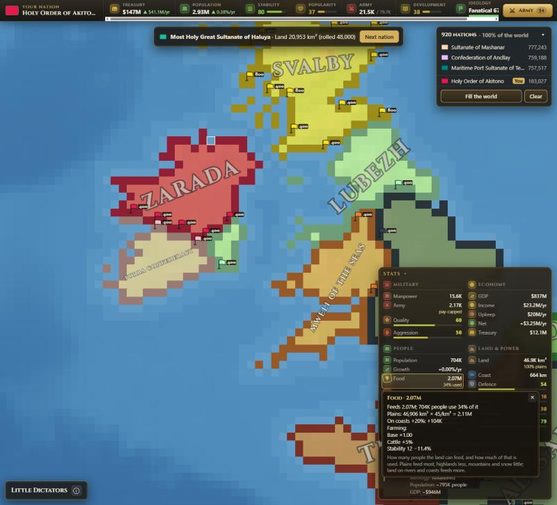
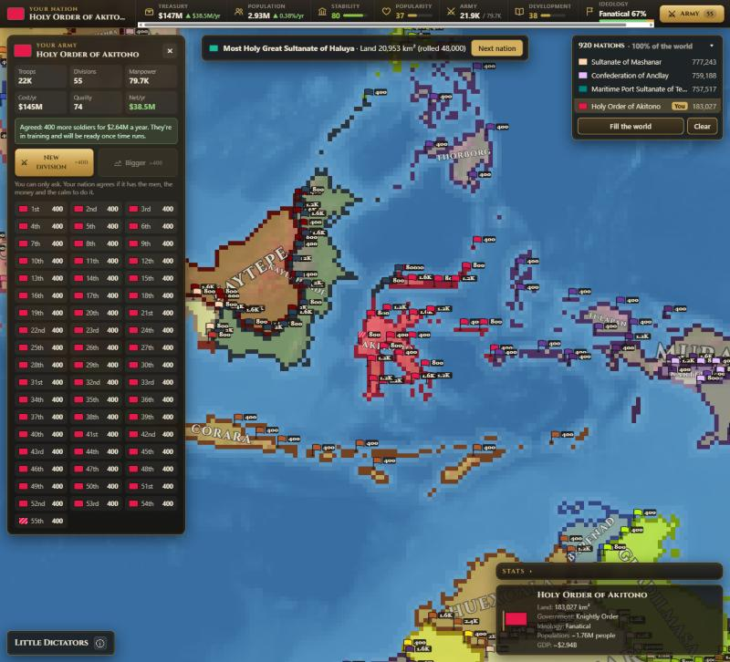
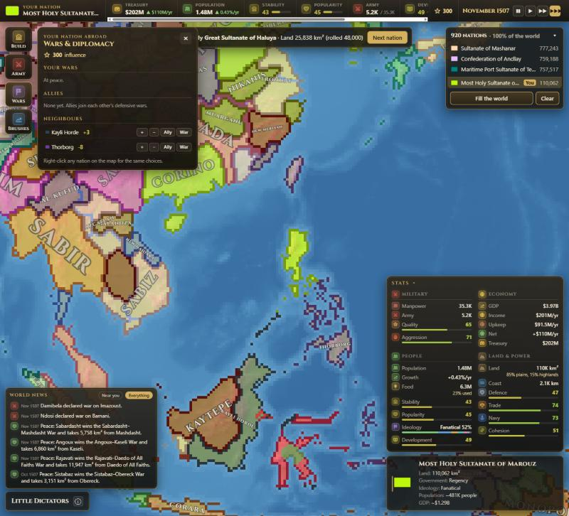
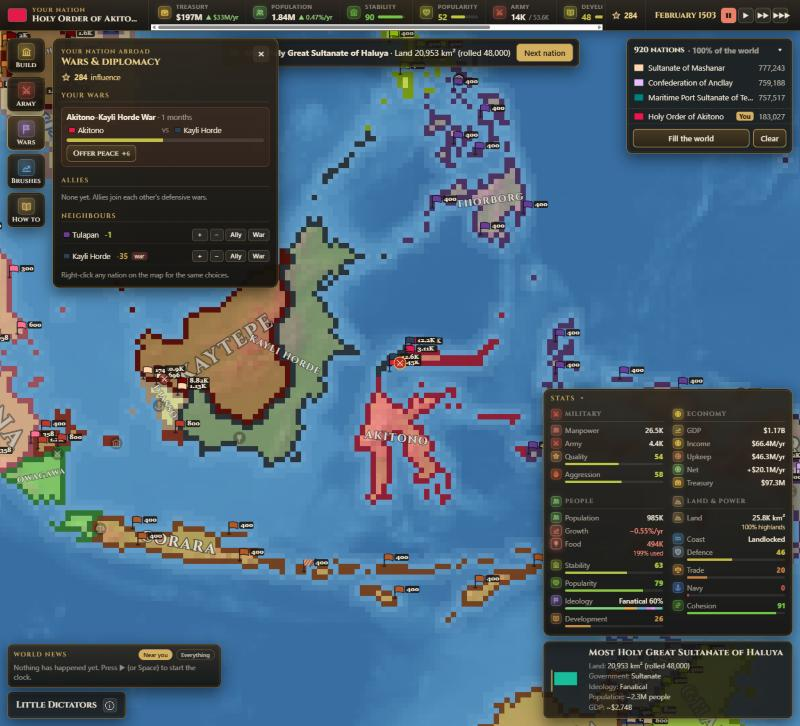

# Little Dictators

A browser game where you spin wheels to create nations on a pixel map of the world,
then watch (and nudge) them grow, ally and fight. See [DESIGN.md](DESIGN.md) for the plan.

## Play online

**https://franer47.github.io/little-dictators/** — the latest version from `main`, for
anyone to try in a browser (no install). It updates by itself a minute or two after
something is merged into `main` (the "Publish to GitHub Pages" job in the Actions tab,
`.github/workflows/pages.yml`). GitHub Pages is free only for public repositories: if the
repository is made private again, the link stops working.

## Running it

You need [Node.js](https://nodejs.org) (LTS).

```bash
npm install      # once, downloads the tools
npm run dev      # starts the game at http://localhost:5173
```

The game opens on a start screen (alpha): pick a map and press **Start** (or Enter, or
double-click a map). To pick another map, reload the page. Then you create your nation on
the wheel (below) while the map loads in the background.

## Creating a nation: the wheel (beta)


The game starts in **1500**, and every wheel fits that time: kingdoms, sultanates,
khanates and merchant republics, no juntas or GDP talk. One big wheel is spun once per
question, **11 spins** in this order:

1. **Government**: Feudal Monarchy, Elected Monarchy, Sultanate, Khanate, Imperial
   Bureaucracy, Merchant Republic, Noble Republic, City-State, Theocracy, Knightly Order,
   Tribal Confederation, Chiefdom, Despot Rule, Warlord Rule, Regency, and a **rare pull**
   (below).
2. **Land size**: a range, then the exact area in km² (never more than 800,000 km², about
   2.25× Germany), with a comparison such as "≈ the size of Portugal". Most nations are
   modest to large (60,000–360,000 km², about 2 in 3 rolls); very big and very small lands
   are rare (360,000+ km²: 12%, under 25,000 km²: 10%).
3. **Population density**: Empty … Crowded, then the exact people per km². **Population =
   land × density**, so a tiny land can never hold millions of people.
4. **Wealth**: Very poor … Very rich, then the exact output per person.
   **GDP = population × output per person**, in today's dollars.
5. **Bonus resources**: spun **3 times**, never the same one twice (grain, iron, silk,
   spices, furs…). Other resources will come from the land itself later.
6. **Ideology**: Traditionalist, Expansionist, Trade-minded, Fanatical, Humanist,
   Isolationist, Militarist, Reformist, Honour-bound, Tolerant, Seafaring, Scholarly,
   Pragmatic, and a **rare pull**.
7. **History**: one story card, e.g. "Recent civil war", "Former empire", "Golden age".
8. **Stability**: Collapsing … Rock solid.
9. **Popularity**: Hated … Revered.
10. **Bonus spin**: slices like "Seeks revenge", "Mandatory enlistment", "Open borders" or
    "Patron of the arts". Each sits at a spot on the nation chart (below); the nearer it is
    to the nation's dot, the bigger its slice.
11. **Golden spin**: first a golden chance wheel. The closer the nation's dot is to a
    corner of the chart, the bigger the chance (up to 60%; about 1 nation in 14 wins). Then
    a gold wheel: half of it doubles something (land, people or wealth, and everything
    that follows from it, even past the usual limits), half is 4 traits for the nation's
    corner ("Wants to become rich", "A world police officer", "Ruthless to others", "Has
    insane conquering ambitions"…).

On the number wheels (land, density, wealth) the second spin's slices show what you'd get
(e.g. "1.4M" people or "$4.2B"), so you can see the numbers add up.

**Rare pulls**: Government and Ideology each have one thin black slice with red edges and
no label, 1.5% of the wheel. Landing on it is "something terrible for the whole world": the
screen darkens, the wheel's centre turns into a skull, and a dark wheel picks one of 7
rare results: governments Eternal Republic, Absolute Monarchy, Stratocracy, Necrocracy,
Syndicalist Federation, Oligarchic Republic, Monastic State; ideologies Eternalism,
Ultranationalism, Satanism, Syndicalism, Sacred Nation, Divine Imperialism,
Apocalypticism. A nation gets at most one rare pull (once it has one, the other wheel's
black slice is gone), so about 3% of nations get one.


**The nation chart**: every result pushes the nation's dot left (liberal, democratic,
peaceful) or right (nationalist, dictatorship), and down (miserable) or up (a good life).
The finished card and the creation record show where it ended up.


The results collect on the nation card in groups (Power, Land & wealth, Story & bonuses). Point at a result (or tab to it) to see what it means and how likely it was. After the
last spin the nation gets a name made from its government and ideology, e.g. "Sultanate of
Al-Basra", "Iron Khanate of Kharkhorum" or "Holy Prince-Bishopric of Witenberg" (click it
to rename, or press the dice for a new one), and **Continue to map** takes you to the map.
The nation panel in the bottom-right corner shows the name and key results; click it for
the **creation record** (every roll, its odds, the date and the random seed). Esc closes it.


For now this is cosmetic: the results are stored and shown but don't change the game yet,
and nothing is saved when you reload.

| Action | Input |
|---|---|
| Spin / next wheel | **Spin** button, Space, Enter, or click the wheel |
| Switch look | **Retro pixel** or **Game show** (top right; remembered) |
| Sound on/off | Speaker button (remembered). Sound starts after your first click or key press. |
| Quick spins for testing | **Skip animation** |
| Roll every wheel that's left at once | **Spin the rest** |


### Tuning the wheels

Everything on the wheels is in data files, so you can change it without touching code
(reload the page after saving):

- **`public/data/wheels.json`** says which era the game uses (`"era": "1500"`), where each
  era's file is (`eras`), and has every word shown on the wheel screen, card and panel
  (`text`).
- **`public/data/eras/1500.json`** has the 1500 wheels, in spin order, plus the name parts.
  Later eras get their own file next to it.

In an era file:

- **Slices**: each has a `label`, a `blurb` (the flavour line) and a `weight`, and
  optionally a `short` label for the wheel itself (the full label shows big when it
  lands). Weights are relative odds: all 1 means equal chances, 2 is twice as likely as 1,
  0 never comes up. Slices take up room on the wheel in proportion to their weight, so what
  you see is the real odds. `"chance": 0.015` gives a slice a fixed share (1.5%) instead.
  `"rare": true` makes a slice a rare pull (black, no label); its `then` is the wheel of
  rare results spun next. `rareLimit` (1) is how many rare pulls a nation can get.
- **The chart**: `chart` names the axes and corners; each slice's `"chart": [x, y]`
  (each -1 to 1, or null) is how it pushes the dot, and `spread` stretches the dot so it
  can reach the corners.
- **Bonus and golden wheels**: `chartWeights` sizes slices by the dot (`"near"`: by
  distance to each slice's `"at": [x, y]`; `"quadrant"`: only the slices for the dot's
  corner, plus those with no `at`). `gate` adds the golden chance wheel first
  (`maxChance` in a corner, `power` = how fast it falls toward the middle). A slice's
  `"effect": { "multiply": { "land": 2 } }` doubles that result.
- **Wheels**: `"off": true` keeps a wheel in the file without spinning it (Culture and
  Religion are kept like this for later); `"picks": 3` spins a wheel 3 times with no
  repeats; `resultName` is what the card calls the result ("Population" for the density
  wheel).
- **Number wheels** (with a `number` block): each slice has a `range` of `[low, high]`.
  `times` chains the wheel to an earlier one (density `times` land = population), `max`
  caps the result, `exactSlices` sets how many numbers the second wheel has, and `range`,
  `value`, `total`, `detail` say how things are written. The `notes` at the top of the
  file say where the ranges come from.
- **Groups**: `groups` sorts the results into sections on the card and in the record;
  `panel.show` picks which results the corner panel shows.
- **Names**: `names.titles` has title patterns per government ("Sultanate of {place}"),
  each government's name `styles` (the syllable sets in `names.places`, e.g. Khanate uses
  turkic and mongol), and `names.modifiers` adds a word from the ideology ("Great {name}",
  "Kingdom of Greater {place}").

If the files have a mistake (e.g. a negative weight, or a range above the land `max`), the
game shows an error saying which file and where.

Testing shortcuts: `?wheel=skip` rolls the whole nation instantly, `?seed=123` makes the
rolls repeatable (the same seed gives the same nation whether you spin or skip), e.g.
<http://localhost:5173/?map=earth-1500&wheel=skip&seed=123>. In the browser console (dev
server only):

- `game.checkWeights()` spins every wheel 100,000 times and prints how often each slice
  won next to its expected odds.
- `game.checkNumbers()` rolls 10,000 nations and prints the smallest, typical and biggest
  land, population and GDP, where the dots land on the chart, the golden chances, how
  often rare pulls and golden spins happen, and the smallest and biggest economy rolled.
- `game.sampleNations(5)` prints a few whole rolled nations.

## Placing nations (the whole world)


After **Continue to map** you choose where your nation goes, **anywhere on Earth** (except
Antarctica). Then either keep making nations yourself (**Next nation**), or press **Fill the
world** and let the game make and place the rest. The nation card and the corner panel
show each nation's **colour**, which is its flag for now.

- **Click any land**, or press **Surprise me** for a random free spot. Surprise
  me (and Fill) start nations on a **coast or riverbank** whenever one with room is left,
  away from other nations, so the water closes off one side and the land grows into a
  fuller shape instead of snaking off; the inland gaps left between them are filled by
  later nations. They never start in a gap smaller than 60,000 km², or in a pocket
  surrounded by just one nation (unless it's at least 150,000 km²), so no clusters of
  dot-sized nations fill the gaps between big ones; those bits go to the nations around
  them at the end of a fill. The dashed circle under the
  mouse is roughly how big the nation will get; a red cross means it can't start there
  (sea, lakes, rivers, ice or another nation).
- The land then **grows out from that spot** in a second or two. Only the rolled land size
  matters for now (a golden "Double land" simply means more land).
- **Next nation** goes back to the wheel for another one. The list in the top-right corner
  shows the **top 3 nations by land plus yours** (marked "You"), under e.g. "925 nations ·
  100% of the world". The arrow opens the full list (biggest first, it scrolls) and closes it
  again; it remembers your choice. Click a row, or a nation on the map, to see it in the
  corner panel. Hovering the map shows who owns the land.
- **Fill the world** rolls and places nations until **95% of the land is taken** (or no gap
  of 60,000 km² is left): usually 900–1,000 nations, in about 3 seconds, and you can watch the map fill
  up ("Filling the world… 241 nations · 28%"). Coasts and riverbanks fill first, then the
  inland gaps. Fill picks each nation's spot first and then rolls its land size for the
  free patch around it: sizes that wouldn't fit there are left off the wheel (and so are
  the two smallest, City-state and Tiny, so Fill doesn't make dot-sized nations; your own
  wheel still has them), so an island
  gets an island-sized nation while the middle of Africa, settled late, still gets big
  ones. Then the **last 5% and the leftover bits** (small gaps, islands, slivers between
  borders) go to the nearest nations instead of to lots of tiny new ones, which spread up to 10 pixels at a time into them (across water to
  reach islands), so **every piece of land is owned** when the game starts. Fill picks colours so
  that nations that touch never share one (with 60+ nations, colours repeat elsewhere).
  **Clear** removes them all.

**How land grows:** from the start spot the nation keeps taking the "cheapest" pixel it
can reach next. Plains are cheap, highlands cost more, snow more again, mountains a lot,
so land spreads quickly across plains and slowly into the mountains, and nations tend to
settle open land rather than push straight through mountain ranges. The sea, lakes, ice
and other nations' land are never taken. Rivers can be crossed but cost a lot (as much as
40 pixels of plains), so they often end up as borders. (Plains 1, highlands 3.5, snow 4,
mountains 15, rivers 40.)

**Islands can grow overseas.** Land can cross short stretches of sea (up to 8 sea pixels in
a row, each costing as much as 25 pixels of plains; the sea itself is never owned). So a
nation that starts on a small island and runs out of room spreads to the next island or
the mainland: a 150,000 km² roll on Corsica takes Corsica, Sardinia and a piece of
Tuscany instead of stopping at 8,000 km². Because the sea is dear, nations only go
overseas when the land around them is used up or the strait is very short. (Setting:
`growth.seaCrossing`.)

 A little smooth randomness ("wobble") keeps borders from being
perfect circles. Afterwards 1-pixel strings are trimmed and tiny holes inside a nation are
filled. Every pixel counts with its **real area in km²** (pixels further north
cover less ground), and growth stops when the nation has its rolled size, so a 340,000
km² roll gets ~340,000 km². If it's boxed in by the sea or other nations first, it stays
smaller, and the panel says so: "Land: 101,254 km² (rolled 240,000)". (A nation that
fills Iceland gets ~101,000 km²; the real Iceland is 103,000 km².)

**Fair sizes north and south.** The flat map stretches land away from the equator: a
pixel in Europe covers about half the km² of one in Africa, so a nation with the same real
size looked about twice as big up north (the same reason Greenland looks huge on maps). To
even that out halfway, a nation's land is scaled by where it starts:
rolled km² × (pixel area there / pixel area at the equator) ^ 0.5. A 400,000 km² roll in
Africa gets ~400,000 km²; in Europe ~280,000 km², which still looks about 1.1–1.4× as big on
the map instead of 2×. The panel always shows the real km² the nation got. (Setting:
`growth.latitudeBalance`: 0 = real km², 1 = the same size on the map.) The same seed and the
same clicks always give the same map.

**The land wheel follows the map.** The fuller the world gets, the rarer the big land
slices: each slice shrinks with how much is already taken (bigger slices shrink faster),
and sizes bigger than the biggest free patch of land shrink to the part that fits or
disappear. The land wheel says how much is left, e.g. "The world: 61M km² of land
left · 48% already taken" (the picture below is from the Europe test). So nations made late roll sizes that still fit, instead of rolling
"Vast" and getting scraps. (Tune it with `room.fullness` on the land wheel in
`public/data/eras/1500.json`.)


Tune it in **`public/data/placement.json`**: which region nations go in (`region`:
`"world"`, or `"europe"` for the Europe test, which fills Europe with 55–70 nations), each
region's outline (longitude/latitude points), how often random starts pick a coast or riverbank (`start.coastPreference`), the
smallest gap they use (`start.minGap`) and the smallest enclave (`start.enclaveArea`), how
much of the land **Fill** gives to new nations before the neighbours take the rest
(`fill.percent`, 95), plus caps on nations and tries, the cost of each terrain, the wobble,
the biggest hole that gets filled (`holeSize`), how far nations spread into the leftovers
per round (`fill.absorbSteps`), how many nations Fill places per look at the map
(`fill.batchArea`, for speed), and the colour list.

## Stats: every nation's numbers

Once a nation has land, the corner panel shows its **stat sheet** above its name: the
numbers the simulation will run on (they don't change over time yet; the clock comes
next). Every nation has one, yours and all of Fill's; click any nation on the map or in the
nation list to see its stats. **Point at a stat** (or Tab to it) to see where the number
comes from, e.g. "Manpower 80K = Population 2.93M × recruit rate 2.7%: Base 2% · Knightly
Order +20% · Fanatical +15% · Highlands (30% of land) +1.5%". The ▾ next to "Stats" folds
the sheet away (remembered).

**Your own nation's key numbers** run along a **strip across the top**: treasury (and how
much it gains or loses a year), population and growth, stability, popularity, army,
development and the ideology mix, plus the **Army** button. Point at any of them for the
breakdown, or click the name to open your nation. (The game's name and the ⓘ button for map
info are in the bottom-left corner.) Every nation's name is written across its land, tilted
along it and as big as it fits, like on a Paradox map.


**Click** any stat (in the strip, the stat sheet or the creation record) to keep its
breakdown open; click it again, press Esc or click anywhere else to close it. Every stat has
its own coloured icon (money gold, people green, military red, sea blue…); stability,
popularity, development, cohesion, growth and net income are coloured by how good they are,
and an icon pulses when something's wrong (starving, losing money, about to collapse).



The stats come from the wheel results **and the land the nation actually got**: a nation
boxed in by its neighbours has fewer people than it rolled, and mountains, coasts and
rivers change food, defence, trade and ships. Money is in today's US dollars.

| Group | Stat | In plain words | Main inputs |
|---|---|---|---|
| Military | **Manpower** | How many men could be called up | Population × recruit rate (government, ideology, traits like Mandatory enlistment, stability, popularity, highlands/mountains) |
| | **Army** | Soldiers under arms in peacetime | Manpower × share kept under arms, but never more than army budget × income ÷ cost per soldier ("pay-capped") |
| | **Quality** | How good each soldier is (0–100, 50 = ordinary) | Government, ideology, history (veterans, long peace), wealth, iron and horses |
| | **Aggression** | How likely it is to start wars (0–100) | The nation chart's left–right position, ideology, history, traits like Seeks revenge or Has insane conquering ambitions |
| Economy | **GDP** | Everything its people make in a year | Population × wealth per person |
| | **Income** | Taxes the state collects each year | GDP × tax rate (about 5%; government, stability, popularity, wealth) |
| | **Upkeep** | What it spends each year | Army × cost per soldier, plus the court and officials (a share of income) |
| | **Net** | What's left each year | Income − upkeep |
| | **Treasury** | Money in the vaults at the start | Income × years of savings (gold, silver, golden age, trade boom; war and fire empty it) |
| People | **Population** | People on its land | Rolled density × the land it got |
| | **Growth** | % per year | Birth rate (about 0.5%/yr) × the room left on the land; negative when over its food. Stability, history, traits |
| | **Food** | How many people the land can feed, and how much is used | Plains 45 people/km², highlands 18, mountains 6, snow 3; +50% on rivers, +20% on coasts; grain, rice, fish, cattle |
| | **Stability** | How solid the state is (0–100) | At the start: the Stability wheel (Collapsing 5 … Rock solid 95), government and traits, as a head start. Once time runs it's **earned by progress** (see below) |
| | **Popularity** | How the people feel about the ruler (0–100) | The Popularity wheel (Hated 5 … Revered 95), plus traits; it nudges stability, taxes and recruits |
| | **Ideology** | What the people believe, in shares | The rolled ideology is the biggest group (35% when collapsing, 75% when rock solid); the rest follow the ideologies near the nation on the chart |
| | **Development** | How advanced it is (0–100) | Wealth, trade, cohesion, learning (Scholarly, Humanist, golden age; Burns books lowers it) and stability |
| Land & power | **Land** | km² it got, and what kind | Plains / highlands / mountains / snow, number of pieces, how compact |
| | **Coast** | Coastline and riverbanks | Land pixels touching sea or lake, and rivers |
| | **Defence** | How hard it is to invade (0–100) | Mountains (+60 if all mountains), highlands, rivers, water borders (an island +25), traits |
| | **Trade** | How much it trades (0–100) | Coast, rivers, valuable resources (spices, silk…), Trade-minded, Seafaring, Merchant Republic |
| | **Navy** | How far its ships reach (0–100) | Coast, Seafaring, timber, fish; a landlocked nation has none |
| | **Cohesion** | How well the land holds together (0–100) | Land outside its main piece, number of islands/exclaves, how spread out it is; government and history |

**Stability changes almost everything.** It isn't just a number on the sheet: the further
it is from 50, the more it pushes taxes, recruits, growth, farming, savings, army quality,
trade, cohesion and development up (stable) or down (unstable), and an unstable nation is
a bit more aggressive. Every breakdown shows its share, e.g. "Stability 80 +3". The amounts
are in `scoreEffects` in the data file (popularity has a few too).

**Once time runs, stability is earned.** The roll on the wheel is only a head start (and it
counts a bit over half as much as rolled, so "Collapsing" isn't a death sentence and "Rock
solid" isn't a free win). Every month each nation checks how it's doing:

- **Economy:** is its income growing, and is its net income positive?
- **Debt:** is its treasury below zero?
- **Food:** is it well fed, or are there more people than food?
- **Population:** is it growing or falling?
- **Development:** is it rising?
- **Buildings:** did it finish any lately?
- **Wars:** did it win or lose one lately?
- **Land:** did it gain or lose land lately?
- **Peace:** how long since its last war?

Each of these is smoothed over a couple of years, or remembered and slowly forgotten for
events like a war. Weighted and added up, they give a **target**, and stability moves a
little toward it every month. Temples and forts, debt and popularity keep their lasting
part. The roll's part fades over the first decade or two, and stability's effects on the rest
of the sheet start at 40% of their strength and grow to full over the same years.

The breakdown says what's going on, e.g. "Now 55, heading for 62 (rising) · Economy growing
+5.0 · Well fed +3.0 · Lost a war −6.7 · Starting roll (fading) +3.1 · Temple (level 1) +4".
All the weights and speeds are in `"stability"` in `public/data/eras/1500-sim.json`.

In a test run on a filled world, the median stability stayed around 60–65. The bottom and top
tenth moved in from 30 and 86 at the start to about 44 and 79 after 50 years. Most nations with
bad rolls climbed above 50, some with great rolls fell under 40, and after 50 years the
starting roll barely predicted stability any more.

The four extra stats (defence, trade, naval reach, cohesion) are there because the coming
simulation needs them: defence for wars and front lines, trade for income and contact
between nations, naval reach for overseas invasions, and cohesion for revolts and
breakaways.

## Armies and fronts

Armies work like Victoria 3's fronts. Every nation's soldiers are **divisions** of 400 troops,
grouped into a few **armies** (about 12 divisions each, at most 6 armies). Each army is **one
token** on the map: the nation's flag, how many divisions it has, a strength bar (green when
full, red when worn down) and its stance on the cloth (▲ attack, ▬ hold, a shield for defend).

- An army is sent to a **front** (the border with one enemy) or stays **at home**, standing
  along the border (on your Defend paint, if you painted some) and guarding every front a
  little.
- Its **stance**: **Attack** pushes into the enemy's land, **Hold** stands its ground
  (stronger in defence, never advances), **Defend** digs in (much stronger in defence, fewer
  losses, never advances).
- New divisions wait in the **Reserve** at the capital (a striped flag with an R) while they
  train, then join an army.
- Worn-down divisions in an army are merged back into full ones, so the numbers stay tidy.

**Every nation commands its own armies**, yours included: it sends them where the enemy is
strongest, attacks where it's stronger and digs in where it's much weaker. You can take over
any of your armies by giving it an order (a front or a stance) in the Army section; it then
says "You command it", and your nation leaves it alone until you press **Give back**.

To keep the map clean, only **your** armies and **your enemies'** show, plus the armies of the
nation whose Army section is open; tick **Show every nation's armies** to see them all. When
an army is sent somewhere else it marches there instead of jumping.

Click an army (or **Army** on the left) to open the **Army section**: troops, divisions,
manpower, yearly cost and quality, every army with its front and stance, and the reserve. For
**your own** nation you can also **order divisions**: **+1**, **+5**, **+25** or **+100** new
divisions of 400 troops (✦1 each). They go into a **queue**, and your nation raises up to 4 a
month on its own, whenever it can. The Army section shows how many are waiting and why
(**Clear** cancels them and gives the influence back).

A division is only raised while your nation is stable enough (stability 25 or more), has the
men (its army stays within its manpower) and can pay (its net income stays above zero);
otherwise the queue waits. New troops are added to its army and upkeep, and they're **in
training** for six months (they don't fight until then). Nations also raise and break up
divisions on their own once a year, and lose troops in wars. Other nations' armies you can
look at but not command. The numbers are in `"divisions"` in
`public/data/eras/1500-stats.json` and `"army"` in `1500-sim.json` (army size, how many
armies, what each stance does, militia, home guard).



### Tuning the stats

Everything is in **`public/data/eras/1500-stats.json`** (no code changes needed; reload the
page). Each "factor" (recruit rate, tax rate, defence…) has a `base`, a `min` and a `max`.
Modifiers are written as text and come from wheel results (`results`, by wheel id and slice
id), the land (`terrain`, scaled by that terrain's share of the land; `access`, scaled by
how much coast or river it has) and the nation chart (`chart`):

```json
"militarist": { "recruitRate": "+30%", "armyQuality": "+10", "aggression": "+20" }
```

`"+30%"` is a percentage (all the percentages are added up, then multiply the base), `"+20"`
is added as is, and `"×0"` multiplies the result. A typo (an unknown wheel, slice, factor
or terrain, or a modifier like `"+30 percent"`) stops the game with a message that says
exactly where the mistake is.

**The stats spreadsheet.** To tune many things at once: `python scripts/stats_sheet.py export`
writes `tuning/1500-stats-list.xlsx` (not kept in git; the JSON file is the real copy), one
row for everything that gives stats (every government, ideology, history, trait, wealth
level, resource, land type, coast, the chart, and what stability and popularity do), with
what it gives now in plain words ("+30% recruit rate, +20 aggression"). Write the new list in
the yellow column, save, and `python scripts/stats_sheet.py import` puts it into the data
file, changing only those lines (and says exactly what changed, or which row it couldn't
read). `export-grid` makes the same as a grid, one column per number, with the starting
values too. The same list also lives on a private Claude page (the "Stat Ledger") where you
can type your changes in the browser; `page-items` makes its list, and `import <answers>.json`
reads its saved answers (`{"w": {row id: text}}`) back in the same way. Needs Python with
`openpyxl` (`pip install openpyxl`).

In the dev server's console, **`game.checkStats()`** prints the smallest, typical and
biggest value of every stat over the nations on the map (press Fill the world first) and
lists anything that looks absurd for 1500; `game.sheet(1)` is the first nation's whole sheet.

## Playing: time runs

Once your nation is on the map the **clock** starts (paused, in January 1500): press **▶**
in the top strip or **Space**, and pick a speed with the buttons or keys **1–3** (×1, ×3,
×10). A month lasts about 3.5 seconds at normal speed, so 1500 → 2000 is about six hours.
Every month each nation's money, people and development change, buildings get built,
divisions train, and wars are fought. The top strip shows the date, your influence and your
nation's numbers; the corner panel updates as time runs.



**You guide, you don't rule.** Your nation decides for itself (once a year it builds what it
needs, raises or breaks up divisions, picks allies and wars, like every other nation), but
you can push it with **influence** ✦. You start with 30 and earn about 2–5 a month, more when
your nation is stable and its ruler is liked. Every push can be refused, with the reason
("it can't afford it", "the state is too unstable", "they're much stronger").

The menu on the left:

- **Build**: eight buildings (Farm, Market, Workshop, Fort, Barracks, Port, School,
  Temple), each with 5 levels. A level costs a year of income for level 1, two years for
  level 2 and so on, takes months to build, and gives stats (e.g. Farm +8% farming and +3%
  birth rate per level). Pushing a building costs ✦6. Two can be built at once; if your
  nation is busy or short of money, the building goes into a **queue** and starts by itself
  later (**Clear** cancels the queue and gives the influence back).
- **Army**: your armies, their fronts and stances (take command of any of them), the
  reserve, and orders for 1, 5, 25 or 100 new divisions (✦1 each) into a queue that's raised a
  few a month. New soldiers train for six months in the reserve first.
- **Wars**: your wars (with the war score), your allies and your neighbours, each with ＋
  / − relations, Ally and War buttons. **Right-click** any nation on the map for the same
  choices.
- **Brushes**: paint the map with influence. **War goal** (other nations' land you want: your
  nation is keener to fight its owner and takes that land first in a peace), **Defend** (your
  armies at home stand there, forts go there first), **Develop** (new buildings go there first, and
  your nation builds more farms, markets, workshops and schools), **Erase** (gives back half).

**Wars are fought pixel by pixel.** Every month the war score moves toward the stronger side
(troops × army quality, defenders helped by their defence), and the armies on the fronts lose
troops (fewer when they hold or dig in; the reserve is safe). Along every **front** (two
enemies whose land touches, or with at most 6 pixels of sea between them) the armies there
fight: if one side's **attacking** armies beat the other's defence (its armies there, a little
from its home armies, and some local militia), it **pushes into the other's land**: the
bigger its edge, the more pixels it takes, and you can watch the border creep forward through
the month. A front with no army on it is held only by militia. Terrain slows it down (a mountain pixel costs four times a plain, highlands and
snow twice, rivers three times, landing across the sea twice), your **Defend** paint makes
land twice as hard to take, and your **War goal** paint is taken first. A nation fighting on
several fronts splits its armies between them. Conquered land is yours at once, **with what's
on it**: the same share of the loser's people as of its land, and the buildings standing there
(buildings still being built there are lost). Take all of a nation's land and you get its
treasury too.

Computer nations make peace when one side is clearly winning (score 50) or after four years.
**When your nation is winning, you decide**: your armies keep conquering until you press
**Make peace** (or eight years pass), and the Wars panel says what peace now would give.
Everyone keeps the land they hold; on top of that, from a score of 20 the loser pays
**tribute** (10% of its income for 10 years, half that to the winner's allies), and a nation
under a quarter of the winner's size is **taken whole** from a score of 90. Allies join each
other's defensive wars. The Wars panel lists your **recent treaties**, and the Wars button
shows how many wars you're in. A nation that loses all its land has **fallen** ("X has fallen
to Y"); if it's yours you can keep watching or pick another nation to guide.

**The other nations are alive.** They don't just wait to be conquered:

- **They plan their wars where you can see them.** A nation that decides to attack first
  **masses troops on the border** for 4–10 months. A turning dashed ring with a flag marks the
  spot on the map, and its armies gather there. Then it declares war, or calls it off if the
  odds turned. If it's aimed at you, a letter warns you, and the Wars panel's **Threats**
  section counts down the months.
- **They raise bigger armies** when they're at war (×1.5), planning one (×1.4) or threatened
  (×1.3), through the same division queue you use.
- **Coalitions.** Starting wars and taking land gives a nation **infamy** (it fades by a
  quarter a year; the Wars panel shows yours). Neighbours who dislike a nation with too much
  infamy (50 or more), or one far stronger than everyone around it, band together. Once the
  coalition is as strong as its target, all its members declare war together.
- **Revolts.** A nation whose stability drops under 20 may lose a region on its far side, away
  from its capital. It breaks away as a **new nation**, rolled on the wheels and different
  from the old regime, with its own people, buildings and the soldiers who deserted there.
  Then it fights a **War of Independence**.

The numbers are in `"ai"` in `public/data/eras/1500-sim.json`.

**On the map**, every war has crossed swords at the middle of its front (big and red when
it's yours), and the armies stand on the fronts they were sent to.

**Animations** keep the map moving between the monthly ticks, at any speed:

- Conquered land **creeps in through the whole month** and glows for a moment in its new
  owner's colour.
- Every battle has a small **bar** under its swords showing who's winning. Each month it
  **flashes** with sparks and smoke, the armies there **lunge** at each other, and for your
  own battles (or the nation whose Army section is open) the troops each side lost **float
  up** in its colour.
- **Ripples** spread from where something happened: a war declared (red, at the defender's
  capital), a peace signed (white), a nation fallen (dark), one of your buildings finished
  (gold).
- In the top strip the numbers **count** to their new values, and a thin bar under the date
  fills up through the month.

With "reduce motion" on in your system settings, the map skips these. Buildings show as small icons where they stand when you zoom in
(faded while they're being built).



**World news** in the bottom-left corner lists wars, treaties and falls near you (or
everything); click one to fly there. Big news about your own nation (a war declared on you, a
peace signed) comes as a **letter** and pauses the game until you've read it. The **How to**
button on the left shows a short guide (it also opens by itself the first time).

The game **saves itself** in your browser every year and when you close the page; the start
screen then shows **Continue**.

All the numbers (clock speed, influence, building costs and effects, what computer nations
do, war and peace rules) are in **`public/data/eras/1500-sim.json`**, with notes in plain
words.

## Controls

| Action | Input |
|---|---|
| Move camera | Drag with the mouse, or WASD / arrow keys (hold Shift for faster) |
| Zoom | Mouse wheel, or Q / E |
| Zoom all the way out | F |
| Pause / go on | Space, or the ❚❚ / ▶ buttons in the top strip |
| Speed ×1, ×3, ×10 | 1, 2, 3 |
| Diplomacy with a nation | Right-click it |
| Paint with a brush | Pick one in Brushes, then drag with the left mouse button (the right button still moves the map); Esc puts it down |
| Map info (what's under the mouse) and the controls | the ⓘ button, bottom left |

## Map edges

The Earth wraps east–west: keep panning right and you come back around from the left,
like in Hearts of Iron. It doesn't wrap north–south: at the furthest zoom the map's
height exactly fills the screen, and you can't pan past the top or bottom edge.
Each map says whether it wraps with `"wrapX"` in its `public/maps/<name>.json`;
`GameMap.wrapX()` / `normalize()` find the real pixel for any x, e.g. a neighbour across the seam.

## Project layout

```
src/
  main.ts                 starts the game
  ui/startMenu.ts         the start screen: pick a map
  ui/wheel/               the wheel screen: flow, the two wheel looks, sounds, confetti
  ui/nationPanel.ts       the nation panel in the corner: stat sheet, creation record
  ui/nationBar.ts         the strip across the top: your nation's key numbers and the Army button
  ui/armyPanel.ts         the Army section: armies, fronts, stances, the reserve, orders for divisions
  game/army.ts            divisions: how many a peacetime army makes, the border lines armies stand along
  sim/armies.ts           armies: grouping divisions, fronts, stances, what each nation decides for its armies
  game/labels.ts          where each nation's name goes on the map
  render/armyLayer.ts     draws the army tokens (they march when sent somewhere else, and lunge in battle)
  render/effectsLayer.ts  the map's animations: conquest glow, battle bars, sparks, smoke, losses, ripples
  render/labelLayer.ts    draws the nation names
  ui/icons.ts             the small stat icons and meter colours
  ui/placement.ts         placing nations: the hint bar, nation list, Surprise me, Fill, Clear
  game/wheels.ts          loads the wheel data, spins (weighted random picks)
  game/nation.ts          a nation and its creation record; chained numbers; name generator
  game/roller.ts          the spin-by-spin rules (rare pulls, exact numbers, picks, golden spin)
  game/chart.ts           the nation chart: the dot, chart-sized slices, the golden chance
  game/stats.ts           the stat sheet: one look over the map for everyone's land, then each nation's numbers
  sim/world.ts            the running world: the monthly tick, money, people, buildings, relations, your pushes and brushes
  sim/ai.ts               what each nation decides: build, recruit, allies, planned wars, coalitions, revolts
  sim/war.ts              simple wars, war score and peace treaties (land, tribute)
  sim/simData.ts          loads and checks public/data/eras/1500-sim.json
  sim/save.ts             saving in the browser (IndexedDB) and Continue
  ui/gameUi.ts            the clock, the left menu and its panels, right-click menu, world news
  render/paintLayer.ts    draws your brush paint on the map
  game/devChecks.ts       console checks: game.checkWeights(), checkNumbers(), sampleNations(), checkStats()
  game/random.ts          seeded random numbers for game logic
  game/territory.ts       who owns each pixel; how a nation's land grows; the Europe region
  map/terrain.ts          terrain types and their (data) colours
  map/projection.ts       turns longitude/latitude into map pixels
  map/gameMap.ts          loads a map into a grid of terrain values + elevation
  render/camera.ts        where the camera looks and how far it's zoomed
  render/mapRenderer.ts   draws the map on screen
  render/territoryLayer.ts draws nations' colours and borders, updating only what changed
  render/terrainColors.ts the shaded look: colour ramps, hillshade, coasts, sea depth
  input/cameraControls.ts mouse + keyboard camera controls
scripts/
  stats_sheet.py          the stats spreadsheet: export the data file to Excel, import it back
  build-earth-map.ts      generates the Earth map from real-world data
  earth-water.json        which lakes and rivers go on the Earth map (editable)
public/maps/              map files (see below)
public/data/wheels.json   which era is used, and the screen text (editable)
public/data/eras/1500.json the 1500 wheels, number ranges and name parts (editable)
public/data/placement.json the Europe region, growth costs and nation colours (editable)
data/raw/                 downloaded source data for the map builder (not committed)
```

## The Earth map


The map runs from 84°N to the South Pole, in the
[Patterson projection](https://en.wikipedia.org/wiki/Patterson_projection) (it keeps
Europe and North America looking like the familiar Miller world map, but squeezes the
poles so Antarctica fits without a huge stretched strip).

### Map sizes

The builder makes the same map in more than one size, from the same data and rules:

| Map | Size | Coastlines | Used for |
|---|---|---|---|
| `earth` | 2000 × 1111 | Natural Earth 1:10m | The main map: the game loads this one. |
| `earth-1500` | 1500 × 833 | Natural Earth 1:50m | The earlier, smaller map, kept for a future map-size option. |
| `earth-6000` | 6000 × 3334 | Natural Earth 1:10m | **Test map** ("Earth (detailed, slow)"): 9× the pixels, so small countries get real shapes instead of a few squares. Finer elevation (every 2 arc-minutes) and the 1:10m lakes and rivers. |

Pick one on the start screen. The list is `MAP_CHOICES` in `src/ui/startMenu.ts`.
For quick testing you can also skip the start screen by naming a map in the address, e.g.
<http://localhost:5173/?map=earth-1500> (any map in `public/maps/` works this way).

The sizes are listed in `MAPS` at the top of `scripts/build-earth-map.ts`; adding a size
is one line. Settings measured in pixels (how far the shallow water reaches, the size of
the snow edge's wiggles, how far a river mouth may be joined to the sea…) were tuned on
the 1500 map and are scaled to each size so they cover the same distance on the ground,
and the shading is scaled the same way, so every size looks alike. Rivers stay exactly
1 pixel wide at every size.

**The detailed map (`earth-6000`)** is about 20 million pixels. It's a 30 MB download (the
heightmap is 29 MB of it, the terrain 1 MB) and the browser tab uses about 1.1 GB of memory,
so it's slower everywhere:

| On a fast desktop (Chrome) | `earth` (2000) | `earth-6000` |
|---|---|---|
| Loading the map (local, after download) | 0.15 s | 1.0 s, + 0.8 s to paint |
| Fill the world (~880 nations) | 3 s | 21 s |
| A month passing | ~25 ms; ~100 ms every third month | ~30 ms; ~200 ms and ~350 ms on two months out of three |

The rules for growing nations that are measured in pixels (how big a hole gets filled in,
how far land may cross the sea, the size of the random patches, how much a river holds land
back, how far the leftovers spread at the end of a fill) were tuned on the 2000 map; on a
wider map they're scaled up so they cover the same ground (`pixelScale` in
`src/game/territory.ts`). On the 2000 and 1500 maps nothing changes. The war and army
rules aren't scaled yet: on the detailed map conquest is slower over the same ground, the
brushes are smaller and painting costs more, and division flags only show further zoomed in.

Each map is three files in `public/maps/` (here for `earth`; `earth-1500` has the same three):

| File | What it is |
|---|---|
| `earth.png` | The terrain **data**: one exact flat colour per terrain type (see `src/map/terrain.ts`). This is what the game logic reads, and what you'd edit to change the map. |
| `earth-height.png` | The **heightmap**, only used for the shaded look and the hover info. Each pixel's height is `red × 256 + green − 32768` metres (negative = below sea level). It's stored this way because browsers only read 8 bits per colour channel. |
| `earth.json` | Size, projection, latitude range, `wrapX`, and where the heightmap is. |

Terrain comes from real elevation, averaged over each pixel:

| Terrain | Rule |
|---|---|
| Ocean / Shallow water | Water (the sea and big lakes); shallow if within about 50 km of land (2 pixels on the 1500 map, 3 on the 2000 map, 8 on the 6000 map, measured as a circle there) |
| River | Major rivers: a line exactly 1 pixel wide (see below). Beats every land type except Ice. |
| Plains | Land below 700 m |
| Highlands | Land from 700 m to 2000 m |
| Mountains | Land 2000 m and higher |
| Ice | Greenland, and all land south of 60°S (Antarctica) |
| Snow | The cold far north: plains and highlands beyond the Arctic tree line (tundra), e.g. northern Canada, Alaska, the Russian Arctic, Chukotka. Higher ground turns snowy further south. |

The thresholds are constants at the top of `scripts/build-earth-map.ts`. The Snow edge
follows a table of the real tree line's latitude around the globe (`TREE_LINE`): it's
far north in Norway (~70°N, warmed by the Gulf Stream) and far south around Hudson Bay
(~57°N). Every 140 m of height counts as one degree further north, and a little noise
keeps the edge from looking like a drawn line.

### Lakes and rivers

Big lakes are ordinary water, the same Ocean / Shallow water as the sea: every natural
lake of at least 5,000 km² (the Great Lakes, Victoria, Tanganyika, Baikal, Ladoga,
Titicaca, Great Bear / Great Slave, Winnipeg, Balkhash…) plus the Aral Sea. Dry salt
pans (Lake Eyre, Lake Torrens) and reservoirs are left out.

Rivers are the River terrain: about 35 major rivers, each an unbroken line exactly 1 pixel
wide that steps only sideways or up/down, never diagonally. So a river cleanly splits the
land on its two banks (nothing can slip through a diagonal gap), and every river runs on
to the sea, lake or river it flows into. River counts as water for drawing and hover, but
unlike the sea, armies will be able to cross it (`crossableByArmies` in
`src/map/terrain.ts`).

Which lakes and rivers are used is set in `scripts/earth-water.json`: the lake size
cutoff, and for each river the Natural Earth names of its pieces (the Yangtze is
"Yangtze", "Chang Jiang", "Jinsha"…), plus a few hand fixes: `dropLines` to leave out side
branches of a delta, `extraLines` to draw stretches the data is missing. The detailed map
uses the 1:10m lakes and rivers, whose lines differ, so a river can have a `"10m"` entry
with settings that replace its own ones for that map only (the 1:10m data has a second
Mackenzie, in Australia, and splits the Brahmaputra's delta differently). Edit it and run
`npm run build:map` again.

### Regenerating it

```bash
npm run build:map
```

This builds every size (`earth`, `earth-1500` and `earth-6000`): about a minute each for
the small ones and a few minutes for `earth-6000`. To build only some, name them:
`npm run build:map -- earth-6000`. It stops with an error if any river ends up touching
another river or the sea only at a corner.

The first run downloads the elevation data (about 50 MB) into `data/raw/etopo1-5min.asc`,
and the Natural Earth lakes and rivers (under 1 MB each) into `data/raw/ne_50m_*.geojson`.
If the download fails, get it by hand from
[this NOAA ERDDAP link](https://coastwatch.pfeg.noaa.gov/erddap/griddap/etopo180.esriAscii?altitude%5B(-90):5:(90)%5D%5B(-180):5:(180)%5D)
(ETOPO1 Ice Surface, every 5th arc-minute, "ESRI ASCII" format) and save it under that name.
For `earth-6000` it also downloads the same data every 2nd arc-minute (about 330 MB, in six
bands of 30° latitude, `data/raw/etopo1-2min-0.asc` to `-5.asc`; the error message gives the
link if one fails) and the 1:10m lakes and rivers (a few MB).

### Data sources

- Coastlines and Greenland: [Natural Earth](https://www.naturalearthdata.com/) 1:10m
  (the 2000 and 6000 maps) and 1:50m (the 1500 map), public domain, via the `world-atlas` package.
- Lakes and rivers: [Natural Earth](https://www.naturalearthdata.com/) 1:50m (1:10m for the
  6000 map) "Lakes" and "Rivers + lake centerlines" (public domain), version 5.1.2, downloaded from the
  [natural-earth-vector](https://github.com/nvkelso/natural-earth-vector) repository.
- Elevation and sea depth: NOAA **ETOPO1** 1 Arc-Minute Global Relief Model, Ice Surface
  version (U.S. Government work, free to use and redistribute), served by NOAA's
  [ERDDAP](https://coastwatch.pfeg.noaa.gov/erddap/griddap/etopo180.html). Amante, C. and
  B. W. Eakins, *ETOPO1 1 Arc-Minute Global Relief Model: Procedures, Data Sources and
  Analysis*, NOAA Technical Memorandum NESDIS NGDC-24, 2009.
