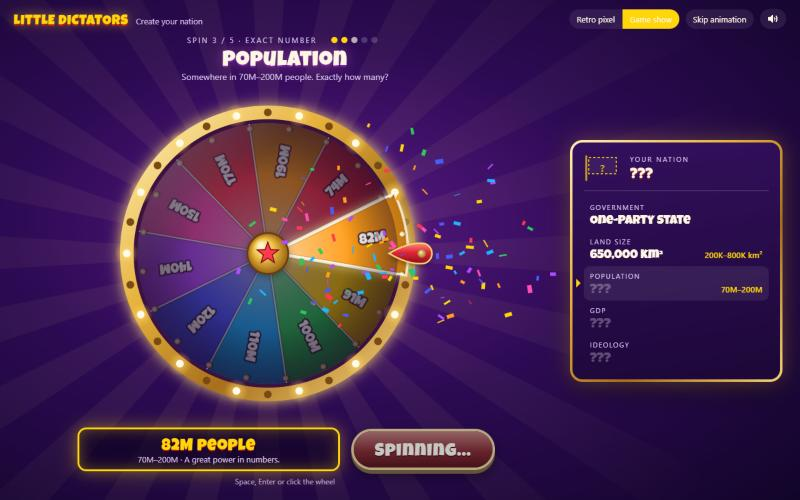
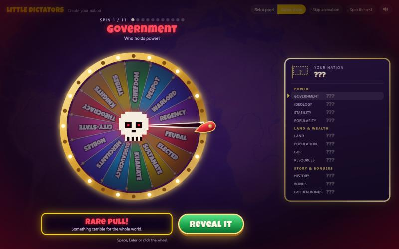
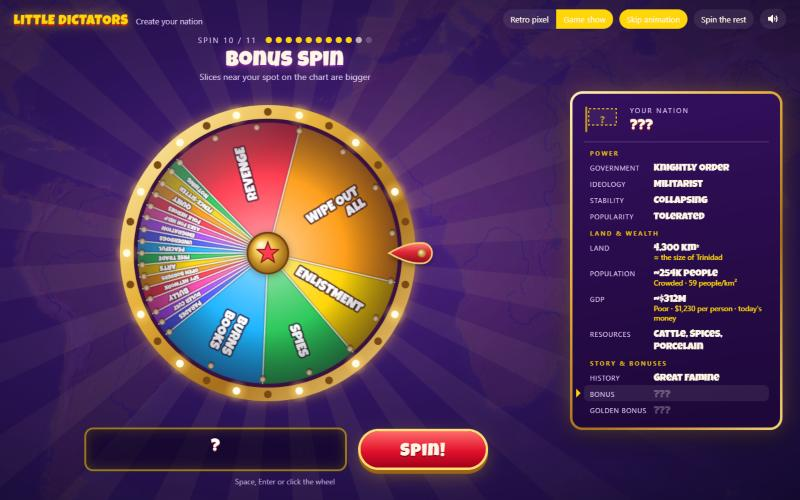
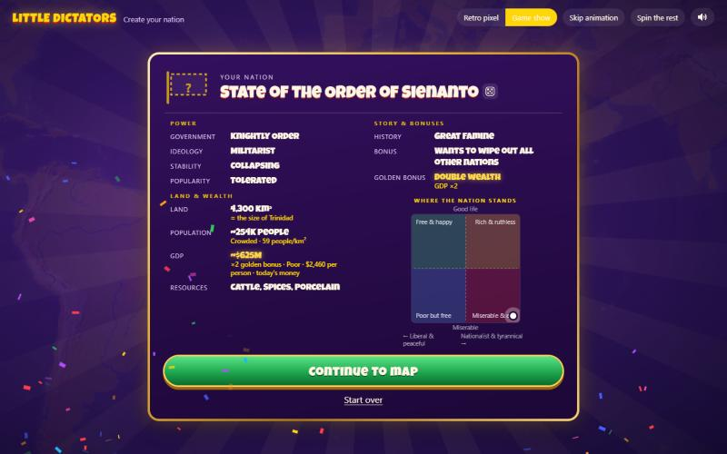
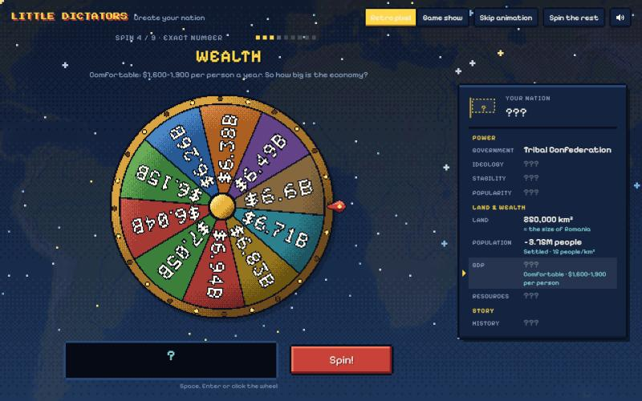
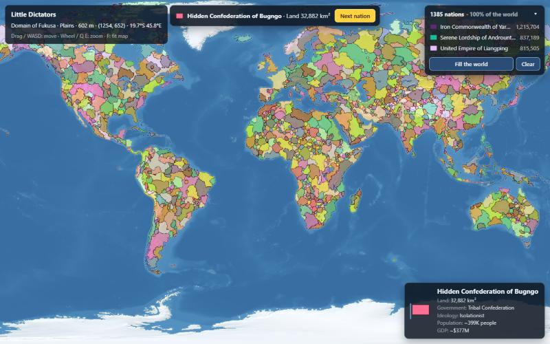
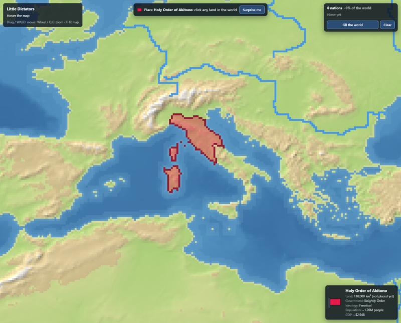
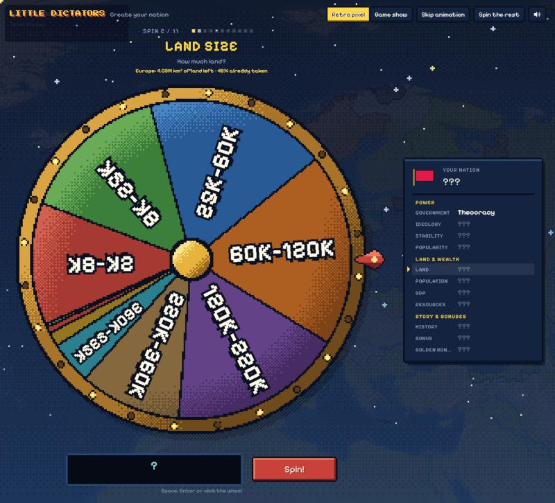
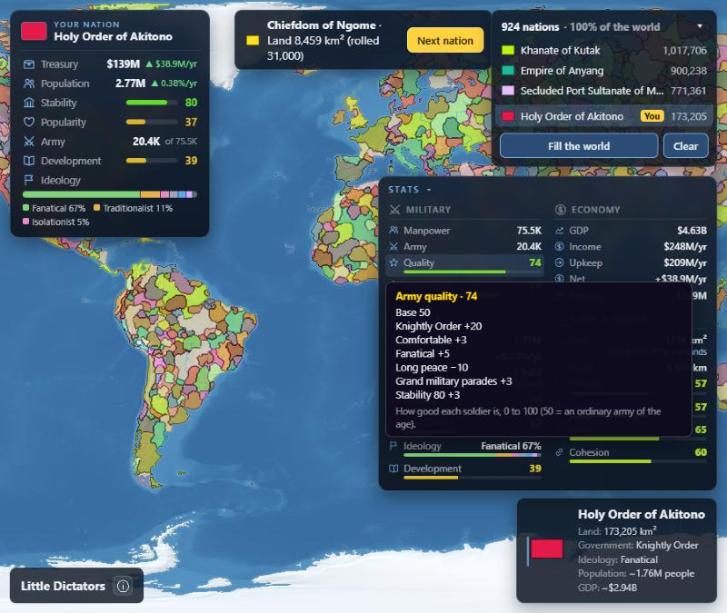
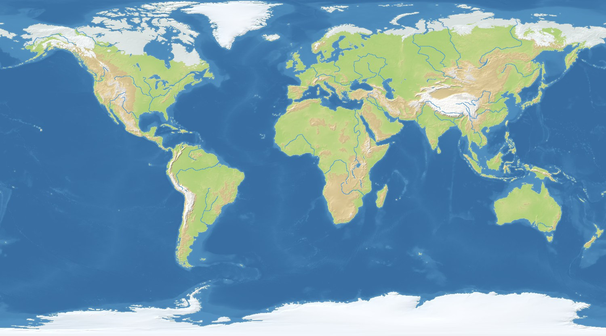

# Little Dictators

A browser game where you spin wheels to create nations on a pixel map of the world,
then watch (and nudge) them grow, ally and fight. See [DESIGN.md](DESIGN.md) for the plan.

## Play online

**https://franer47.github.io/little-dictators/** — the latest version from `main`, for
anyone to try in a browser (no install). It updates by itself a minute or two after
something is merged into `main` (the "Publish to GitHub Pages" job in the Actions tab,
`.github/workflows/pages.yml`). GitHub Pages is free only for public repositories: if the
repository is made private again, the link stops working.

## Running it

You need [Node.js](https://nodejs.org) (LTS).

```bash
npm install      # once, downloads the tools
npm run dev      # starts the game at http://localhost:5173
```

The game opens on a start screen (alpha): pick a map and press **Start** (or Enter, or
double-click a map). To pick another map, reload the page. Then you create your nation on
the wheel (below) while the map loads in the background.

## Creating a nation: the wheel (beta)



The game starts in **1500**, and every wheel fits that time: kingdoms, sultanates,
khanates and merchant republics, no juntas or GDP talk. One big wheel is spun once per
question, **11 spins** in this order:

1. **Government**: Feudal Monarchy, Elected Monarchy, Sultanate, Khanate, Imperial
   Bureaucracy, Merchant Republic, Noble Republic, City-State, Theocracy, Knightly Order,
   Tribal Confederation, Chiefdom, Despot Rule, Warlord Rule, Regency, and a **rare pull**
   (below).
2. **Land size**: a range, then the exact area in km² (never more than 800,000 km², about
   2.25× Germany), with a comparison such as "≈ the size of Portugal". Most nations are
   modest to large (60,000–360,000 km², about 2 in 3 rolls); very big and very small lands
   are rare (360,000+ km²: 12%, under 25,000 km²: 10%).
3. **Population density**: Empty … Crowded, then the exact people per km². **Population =
   land × density**, so a tiny land can never hold millions of people.
4. **Wealth**: Very poor … Very rich, then the exact output per person.
   **GDP = population × output per person**, in today's dollars.
5. **Bonus resources**: spun **3 times**, never the same one twice (grain, iron, silk,
   spices, furs…). Other resources will come from the land itself later.
6. **Ideology**: Traditionalist, Expansionist, Trade-minded, Fanatical, Humanist,
   Isolationist, Militarist, Reformist, Honour-bound, Tolerant, Seafaring, Scholarly,
   Pragmatic, and a **rare pull**.
7. **History**: one story card, e.g. "Recent civil war", "Former empire", "Golden age".
8. **Stability**: Collapsing … Rock solid.
9. **Popularity**: Hated … Revered.
10. **Bonus spin**: slices like "Seeks revenge", "Mandatory enlistment", "Open borders" or
    "Patron of the arts". Each sits at a spot on the nation chart (below); the nearer it is
    to the nation's dot, the bigger its slice.
11. **Golden spin**: first a golden chance wheel. The closer the nation's dot is to a
    corner of the chart, the bigger the chance (up to 60%; about 1 nation in 14 wins). Then
    a gold wheel: half of it doubles something (land, people or wealth, and everything
    that follows from it, even past the usual limits), half is 4 traits for the nation's
    corner ("Wants to become rich", "A world police officer", "Ruthless to others", "Has
    insane conquering ambitions"…).

On the number wheels (land, density, wealth) the second spin's slices show what you'd get
(e.g. "1.4M" people or "$4.2B"), so you can see the numbers add up.

**Rare pulls**: Government and Ideology each have one thin black slice with red edges and
no label, 1.5% of the wheel. Landing on it is "something terrible for the whole world": the
screen darkens, the wheel's centre turns into a skull, and a dark wheel picks one of 7
rare results: governments Eternal Republic, Absolute Monarchy, Stratocracy, Necrocracy,
Syndicalist Federation, Oligarchic Republic, Monastic State; ideologies Eternalism,
Ultranationalism, Satanism, Syndicalism, Sacred Nation, Divine Imperialism,
Apocalypticism. A nation gets at most one rare pull (once it has one, the other wheel's
black slice is gone), so about 3% of nations get one.



**The nation chart**: every result pushes the nation's dot left (liberal, democratic,
peaceful) or right (nationalist, dictatorship), and down (miserable) or up (a good life).
The finished card and the creation record show where it ended up.



The results collect on the nation card in groups (Power, Land & wealth, Story & bonuses). Point at a result (or tab to it) to see what it means and how likely it was. After the
last spin the nation gets a name made from its government and ideology, e.g. "Sultanate of
Al-Basra", "Iron Khanate of Kharkhorum" or "Holy Prince-Bishopric of Witenberg" (click it
to rename, or press the dice for a new one), and **Continue to map** takes you to the map.
The nation panel in the bottom-right corner shows the name and key results; click it for
the **creation record** (every roll, its odds, the date and the random seed). Esc closes it.



For now this is cosmetic: the results are stored and shown but don't change the game yet,
and nothing is saved when you reload.

| Action | Input |
|---|---|
| Spin / next wheel | **Spin** button, Space, Enter, or click the wheel |
| Switch look | **Retro pixel** or **Game show** (top right; remembered) |
| Sound on/off | Speaker button (remembered). Sound starts after your first click or key press. |
| Quick spins for testing | **Skip animation** |
| Roll every wheel that's left at once | **Spin the rest** |



### Tuning the wheels

Everything on the wheels is in data files, so you can change it without touching code
(reload the page after saving):

- **`public/data/wheels.json`** says which era the game uses (`"era": "1500"`), where each
  era's file is (`eras`), and has every word shown on the wheel screen, card and panel
  (`text`).
- **`public/data/eras/1500.json`** has the 1500 wheels, in spin order, plus the name parts.
  Later eras get their own file next to it.

In an era file:

- **Slices**: each has a `label`, a `blurb` (the flavour line) and a `weight`, and
  optionally a `short` label for the wheel itself (the full label shows big when it
  lands). Weights are relative odds: all 1 means equal chances, 2 is twice as likely as 1,
  0 never comes up. Slices take up room on the wheel in proportion to their weight, so what
  you see is the real odds. `"chance": 0.015` gives a slice a fixed share (1.5%) instead.
  `"rare": true` makes a slice a rare pull (black, no label); its `then` is the wheel of
  rare results spun next. `rareLimit` (1) is how many rare pulls a nation can get.
- **The chart**: `chart` names the axes and corners; each slice's `"chart": [x, y]`
  (each -1 to 1, or null) is how it pushes the dot, and `spread` stretches the dot so it
  can reach the corners.
- **Bonus and golden wheels**: `chartWeights` sizes slices by the dot (`"near"`: by
  distance to each slice's `"at": [x, y]`; `"quadrant"`: only the slices for the dot's
  corner, plus those with no `at`). `gate` adds the golden chance wheel first
  (`maxChance` in a corner, `power` = how fast it falls toward the middle). A slice's
  `"effect": { "multiply": { "land": 2 } }` doubles that result.
- **Wheels**: `"off": true` keeps a wheel in the file without spinning it (Culture and
  Religion are kept like this for later); `"picks": 3` spins a wheel 3 times with no
  repeats; `resultName` is what the card calls the result ("Population" for the density
  wheel).
- **Number wheels** (with a `number` block): each slice has a `range` of `[low, high]`.
  `times` chains the wheel to an earlier one (density `times` land = population), `max`
  caps the result, `exactSlices` sets how many numbers the second wheel has, and `range`,
  `value`, `total`, `detail` say how things are written. The `notes` at the top of the
  file say where the ranges come from.
- **Groups**: `groups` sorts the results into sections on the card and in the record;
  `panel.show` picks which results the corner panel shows.
- **Names**: `names.titles` has title patterns per government ("Sultanate of {place}"),
  each government's name `styles` (the syllable sets in `names.places`, e.g. Khanate uses
  turkic and mongol), and `names.modifiers` adds a word from the ideology ("Great {name}",
  "Kingdom of Greater {place}").

If the files have a mistake (e.g. a negative weight, or a range above the land `max`), the
game shows an error saying which file and where.

Testing shortcuts: `?wheel=skip` rolls the whole nation instantly, `?seed=123` makes the
rolls repeatable (the same seed gives the same nation whether you spin or skip), e.g.
<http://localhost:5173/?map=earth-1500&wheel=skip&seed=123>. In the browser console (dev
server only):

- `game.checkWeights()` spins every wheel 100,000 times and prints how often each slice
  won next to its expected odds.
- `game.checkNumbers()` rolls 10,000 nations and prints the smallest, typical and biggest
  land, population and GDP, where the dots land on the chart, the golden chances, how
  often rare pulls and golden spins happen, and the smallest and biggest economy rolled.
- `game.sampleNations(5)` prints a few whole rolled nations.

## Placing nations (the whole world)



After **Continue to map** you choose where your nation goes, **anywhere on Earth** (except
Antarctica). Then either keep making nations yourself (**Next nation**), or press **Fill the
world** and let the game make and place the rest. The nation card and the corner panel
show each nation's **colour**, which is its flag for now.

- **Click any land**, or press **Surprise me** for a random free spot. Surprise
  me (and Fill) start nations on a **coast or riverbank** whenever one with room is left,
  away from other nations, so the water closes off one side and the land grows into a
  fuller shape instead of snaking off; the inland gaps left between them are filled by
  later nations. They never start in a gap smaller than 60,000 km², or in a pocket
  surrounded by just one nation (unless it's at least 150,000 km²), so no clusters of
  dot-sized nations fill the gaps between big ones; those bits go to the nations around
  them at the end of a fill. The dashed circle under the
  mouse is roughly how big the nation will get; a red cross means it can't start there
  (sea, lakes, rivers, ice or another nation).
- The land then **grows out from that spot** in a second or two. Only the rolled land size
  matters for now (a golden "Double land" simply means more land).
- **Next nation** goes back to the wheel for another one. The list in the top-right corner
  shows the **top 3 nations by land plus yours** (marked "You"), under e.g. "925 nations ·
  100% of the world". The arrow opens the full list (biggest first, it scrolls) and closes it
  again; it remembers your choice. Click a row, or a nation on the map, to see it in the
  corner panel. Hovering the map shows who owns the land.
- **Fill the world** rolls and places nations until **95% of the land is taken** (or no gap
  of 60,000 km² is left): usually 900–1,000 nations, in about 3 seconds, and you can watch the map fill
  up ("Filling the world… 241 nations · 28%"). Coasts and riverbanks fill first, then the
  inland gaps. Fill picks each nation's spot first and then rolls its land size for the
  free patch around it: sizes that wouldn't fit there are left off the wheel (and so are
  the two smallest, City-state and Tiny, so Fill doesn't make dot-sized nations; your own
  wheel still has them), so an island
  gets an island-sized nation while the middle of Africa, settled late, still gets big
  ones. Then the **last 5% and the leftover bits** (small gaps, islands, slivers between
  borders) go to the nearest nations instead of to lots of tiny new ones, which spread up to 10 pixels at a time into them (across water to
  reach islands), so **every piece of land is owned** when the game starts. Fill picks colours so
  that nations that touch never share one (with 60+ nations, colours repeat elsewhere).
  **Clear** removes them all.

**How land grows:** from the start spot the nation keeps taking the "cheapest" pixel it
can reach next. Plains are cheap, highlands cost more, snow more again, mountains a lot,
so land spreads quickly across plains and slowly into the mountains, and nations tend to
settle open land rather than push straight through mountain ranges. The sea, lakes, ice
and other nations' land are never taken. Rivers can be crossed but cost a lot (as much as
40 pixels of plains), so they often end up as borders. (Plains 1, highlands 3.5, snow 4,
mountains 15, rivers 40.)

**Islands can grow overseas.** Land can cross short stretches of sea (up to 8 sea pixels in
a row, each costing as much as 25 pixels of plains; the sea itself is never owned). So a
nation that starts on a small island and runs out of room spreads to the next island or
the mainland: a 150,000 km² roll on Corsica takes Corsica, Sardinia and a piece of
Tuscany instead of stopping at 8,000 km². Because the sea is dear, nations only go
overseas when the land around them is used up or the strait is very short. (Setting:
`growth.seaCrossing`.)

 A little smooth randomness ("wobble") keeps borders from being
perfect circles. Afterwards 1-pixel strings are trimmed and tiny holes inside a nation are
filled. Every pixel counts with its **real area in km²** (pixels further north
cover less ground), and growth stops when the nation has its rolled size, so a 340,000
km² roll gets ~340,000 km². If it's boxed in by the sea or other nations first, it stays
smaller, and the panel says so: "Land: 101,254 km² (rolled 240,000)". (A nation that
fills Iceland gets ~101,000 km²; the real Iceland is 103,000 km².)

**Fair sizes north and south.** The flat map stretches land away from the equator: a
pixel in Europe covers about half the km² of one in Africa, so a nation with the same real
size looked about twice as big up north (the same reason Greenland looks huge on maps). To
even that out halfway, a nation's land is scaled by where it starts:
rolled km² × (pixel area there / pixel area at the equator) ^ 0.5. A 400,000 km² roll in
Africa gets ~400,000 km²; in Europe ~280,000 km², which still looks about 1.1–1.4× as big on
the map instead of 2×. The panel always shows the real km² the nation got. (Setting:
`growth.latitudeBalance`: 0 = real km², 1 = the same size on the map.) The same seed and the
same clicks always give the same map.

**The land wheel follows the map.** The fuller the world gets, the rarer the big land
slices: each slice shrinks with how much is already taken (bigger slices shrink faster),
and sizes bigger than the biggest free patch of land shrink to the part that fits or
disappear. The land wheel says how much is left, e.g. "The world: 61M km² of land
left · 48% already taken" (the picture below is from the Europe test). So nations made late roll sizes that still fit, instead of rolling
"Vast" and getting scraps. (Tune it with `room.fullness` on the land wheel in
`public/data/eras/1500.json`.)



Tune it in **`public/data/placement.json`**: which region nations go in (`region`:
`"world"`, or `"europe"` for the Europe test, which fills Europe with 55–70 nations), each
region's outline (longitude/latitude points), how often random starts pick a coast or riverbank (`start.coastPreference`), the
smallest gap they use (`start.minGap`) and the smallest enclave (`start.enclaveArea`), how
much of the land **Fill** gives to new nations before the neighbours take the rest
(`fill.percent`, 95), plus caps on nations and tries, the cost of each terrain, the wobble,
the biggest hole that gets filled (`holeSize`), how far nations spread into the leftovers
per round (`fill.absorbSteps`), how many nations Fill places per look at the map
(`fill.batchArea`, for speed), and the colour list.

## Stats: every nation's numbers

Once a nation has land, the corner panel shows its **stat sheet** above its name: the
numbers the simulation will run on (they don't change over time yet; the clock comes
next). Every nation has one, yours and all of Fill's; click any nation on the map or in the
nation list to see its stats. **Point at a stat** (or Tab to it) to see where the number
comes from, e.g. "Manpower 80K = Population 2.93M × recruit rate 2.7%: Base 2% · Knightly
Order +20% · Fanatical +15% · Highlands (30% of land) +1.5%". The ▾ next to "Stats" folds
the sheet away (remembered).

**Your own nation's key numbers** stay in the **top-left corner**: treasury (and how much it
gains or loses a year), population and growth, stability, popularity, army, development and
the ideology mix. Point at any of them for the breakdown, or click the name to open your
nation. (The game's name and the ⓘ button for map info moved to the bottom-left corner.)



The stats come from the wheel results **and the land the nation actually got**: a nation
boxed in by its neighbours has fewer people than it rolled, and mountains, coasts and
rivers change food, defence, trade and ships. Money is in today's US dollars.

| Group | Stat | In plain words | Main inputs |
|---|---|---|---|
| Military | **Manpower** | How many men could be called up | Population × recruit rate (government, ideology, traits like Mandatory enlistment, stability, popularity, highlands/mountains) |
| | **Army** | Soldiers under arms in peacetime | Manpower × share kept under arms, but never more than army budget × income ÷ cost per soldier ("pay-capped") |
| | **Quality** | How good each soldier is (0–100, 50 = ordinary) | Government, ideology, history (veterans, long peace), wealth, iron and horses |
| | **Aggression** | How likely it is to start wars (0–100) | The nation chart's left–right position, ideology, history, traits like Seeks revenge or Has insane conquering ambitions |
| Economy | **GDP** | Everything its people make in a year | Population × wealth per person |
| | **Income** | Taxes the state collects each year | GDP × tax rate (about 5%; government, stability, popularity, wealth) |
| | **Upkeep** | What it spends each year | Army × cost per soldier, plus the court and officials (a share of income) |
| | **Net** | What's left each year | Income − upkeep |
| | **Treasury** | Money in the vaults at the start | Income × years of savings (gold, silver, golden age, trade boom; war and fire empty it) |
| People | **Population** | People on its land | Rolled density × the land it got |
| | **Growth** | % per year | Birth rate (about 0.5%/yr) × the room left on the land; negative when over its food. Stability, history, traits |
| | **Food** | How many people the land can feed, and how much is used | Plains 45 people/km², highlands 18, mountains 6, snow 3; +50% on rivers, +20% on coasts; grain, rice, fish, cattle |
| | **Stability** | How solid the state is (0–100) | The Stability wheel (Collapsing 5 … Rock solid 95), plus government and traits |
| | **Popularity** | How the people feel about the ruler (0–100) | The Popularity wheel (Hated 5 … Revered 95), plus traits; it nudges stability, taxes and recruits |
| | **Ideology** | What the people believe, in shares | The rolled ideology is the biggest group (35% when collapsing, 75% when rock solid); the rest follow the ideologies near the nation on the chart |
| | **Development** | How advanced it is (0–100) | Wealth, trade, cohesion, learning (Scholarly, Humanist, golden age; Burns books lowers it) and stability |
| Land & power | **Land** | km² it got, and what kind | Plains / highlands / mountains / snow, number of pieces, how compact |
| | **Coast** | Coastline and riverbanks | Land pixels touching sea or lake, and rivers |
| | **Defence** | How hard it is to invade (0–100) | Mountains (+60 if all mountains), highlands, rivers, water borders (an island +25), traits |
| | **Trade** | How much it trades (0–100) | Coast, rivers, valuable resources (spices, silk…), Trade-minded, Seafaring, Merchant Republic |
| | **Navy** | How far its ships reach (0–100) | Coast, Seafaring, timber, fish; a landlocked nation has none |
| | **Cohesion** | How well the land holds together (0–100) | Land outside its main piece, number of islands/exclaves, how spread out it is; government and history |

**Stability changes almost everything.** It isn't just a number on the sheet: the further
it is from 50, the more it pushes taxes, recruits, growth, farming, savings, army quality,
trade, cohesion and development up (stable) or down (unstable), and an unstable nation is
a bit more aggressive. Every breakdown shows its share, e.g. "Stability 80 +3". The amounts
are in `scoreEffects` in the data file (popularity has a few too).

The four extra stats (defence, trade, naval reach, cohesion) are there because the coming
simulation needs them: defence for wars and front lines, trade for income and contact
between nations, naval reach for overseas invasions, and cohesion for revolts and
breakaways.

### Tuning the stats

Everything is in **`public/data/eras/1500-stats.json`** (no code changes needed; reload the
page). Each "factor" (recruit rate, tax rate, defence…) has a `base`, a `min` and a `max`.
Modifiers are written as text and come from wheel results (`results`, by wheel id and slice
id), the land (`terrain`, scaled by that terrain's share of the land; `access`, scaled by
how much coast or river it has) and the nation chart (`chart`):

```json
"militarist": { "recruitRate": "+30%", "armyQuality": "+10", "aggression": "+20" }
```

`"+30%"` is a percentage (all the percentages are added up, then multiply the base), `"+20"`
is added as is, and `"×0"` multiplies the result. A typo (an unknown wheel, slice, factor
or terrain, or a modifier like `"+30 percent"`) stops the game with a message that says
exactly where the mistake is.

In the dev server's console, **`game.checkStats()`** prints the smallest, typical and
biggest value of every stat over the nations on the map (press Fill the world first) and
lists anything that looks absurd for 1500; `game.sheet(1)` is the first nation's whole sheet.

## Controls

| Action | Input |
|---|---|
| Move camera | Drag with the mouse, or WASD / arrow keys (hold Shift for faster) |
| Zoom | Mouse wheel, or Q / E |
| Zoom all the way out | F |
| Map info (what's under the mouse) and the controls | the ⓘ button, bottom left |

## Map edges

The Earth wraps east–west: keep panning right and you come back around from the left,
like in Hearts of Iron. It doesn't wrap north–south: at the furthest zoom the map's
height exactly fills the screen, and you can't pan past the top or bottom edge.
Each map says whether it wraps with `"wrapX"` in its `public/maps/<name>.json`;
`GameMap.wrapX()` / `normalize()` find the real pixel for any x, e.g. a neighbour across the seam.

## Project layout

```
src/
  main.ts                 starts the game
  ui/startMenu.ts         the start screen: pick a map
  ui/wheel/               the wheel screen: flow, the two wheel looks, sounds, confetti
  ui/nationPanel.ts       the nation panel in the corner: stat sheet, creation record
  ui/nationBar.ts         your nation's key numbers in the top-left corner
  ui/icons.ts             the small stat icons and meter colours
  ui/placement.ts         placing nations: the hint bar, nation list, Surprise me, Fill, Clear
  game/wheels.ts          loads the wheel data, spins (weighted random picks)
  game/nation.ts          a nation and its creation record; chained numbers; name generator
  game/roller.ts          the spin-by-spin rules (rare pulls, exact numbers, picks, golden spin)
  game/chart.ts           the nation chart: the dot, chart-sized slices, the golden chance
  game/stats.ts           the stat sheet: one look over the map for everyone's land, then each nation's numbers
  game/devChecks.ts       console checks: game.checkWeights(), checkNumbers(), sampleNations(), checkStats()
  game/random.ts          seeded random numbers for game logic
  game/territory.ts       who owns each pixel; how a nation's land grows; the Europe region
  map/terrain.ts          terrain types and their (data) colours
  map/projection.ts       turns longitude/latitude into map pixels
  map/gameMap.ts          loads a map into a grid of terrain values + elevation
  render/camera.ts        where the camera looks and how far it's zoomed
  render/mapRenderer.ts   draws the map on screen
  render/territoryLayer.ts draws nations' colours and borders, updating only what changed
  render/terrainColors.ts the shaded look: colour ramps, hillshade, coasts, sea depth
  input/cameraControls.ts mouse + keyboard camera controls
scripts/
  build-earth-map.ts      generates the Earth map from real-world data
  earth-water.json        which lakes and rivers go on the Earth map (editable)
public/maps/              map files (see below)
public/data/wheels.json   which era is used, and the screen text (editable)
public/data/eras/1500.json the 1500 wheels, number ranges and name parts (editable)
public/data/placement.json the Europe region, growth costs and nation colours (editable)
data/raw/                 downloaded source data for the map builder (not committed)
```

## The Earth map



The map runs from 84°N to the South Pole, in the
[Patterson projection](https://en.wikipedia.org/wiki/Patterson_projection) (it keeps
Europe and North America looking like the familiar Miller world map, but squeezes the
poles so Antarctica fits without a huge stretched strip).

### Map sizes

The builder makes the same map in more than one size, from the same data and rules:

| Map | Size | Coastlines | Used for |
|---|---|---|---|
| `earth` | 2000 × 1111 | Natural Earth 1:10m | The main map: the game loads this one. |
| `earth-1500` | 1500 × 833 | Natural Earth 1:50m | The earlier, smaller map, kept for a future map-size option. |

Pick either one on the start screen. The list is `MAP_CHOICES` in `src/ui/startMenu.ts`.
For quick testing you can also skip the start screen by naming a map in the address, e.g.
<http://localhost:5173/?map=earth-1500> (any map in `public/maps/` works this way).

The sizes are listed in `MAPS` at the top of `scripts/build-earth-map.ts`; adding a size
is one line. Settings measured in pixels (how far the shallow water reaches, the size of
the snow edge's wiggles, how far a river mouth may be joined to the sea…) were tuned on
the 1500 map and are scaled to each size so they cover the same distance on the ground,
and the shading is scaled the same way, so every size looks alike. Rivers stay exactly
1 pixel wide at every size.

Each map is three files in `public/maps/` (here for `earth`; `earth-1500` has the same three):

| File | What it is |
|---|---|
| `earth.png` | The terrain **data**: one exact flat colour per terrain type (see `src/map/terrain.ts`). This is what the game logic reads, and what you'd edit to change the map. |
| `earth-height.png` | The **heightmap**, only used for the shaded look and the hover info. Each pixel's height is `red × 256 + green − 32768` metres (negative = below sea level). It's stored this way because browsers only read 8 bits per colour channel. |
| `earth.json` | Size, projection, latitude range, `wrapX`, and where the heightmap is. |

Terrain comes from real elevation, averaged over each pixel:

| Terrain | Rule |
|---|---|
| Ocean / Shallow water | Water (the sea and big lakes); shallow if within about 50 km of land (2 pixels on the 1500 map, 3 on the 2000 map) |
| River | Major rivers: a line exactly 1 pixel wide (see below). Beats every land type except Ice. |
| Plains | Land below 700 m |
| Highlands | Land from 700 m to 2000 m |
| Mountains | Land 2000 m and higher |
| Ice | Greenland, and all land south of 60°S (Antarctica) |
| Snow | The cold far north: plains and highlands beyond the Arctic tree line (tundra), e.g. northern Canada, Alaska, the Russian Arctic, Chukotka. Higher ground turns snowy further south. |

The thresholds are constants at the top of `scripts/build-earth-map.ts`. The Snow edge
follows a table of the real tree line's latitude around the globe (`TREE_LINE`): it's
far north in Norway (~70°N, warmed by the Gulf Stream) and far south around Hudson Bay
(~57°N). Every 140 m of height counts as one degree further north, and a little noise
keeps the edge from looking like a drawn line.

### Lakes and rivers

Big lakes are ordinary water, the same Ocean / Shallow water as the sea: every natural
lake of at least 5,000 km² (the Great Lakes, Victoria, Tanganyika, Baikal, Ladoga,
Titicaca, Great Bear / Great Slave, Winnipeg, Balkhash…) plus the Aral Sea. Dry salt
pans (Lake Eyre, Lake Torrens) and reservoirs are left out.

Rivers are the River terrain: about 35 major rivers, each an unbroken line exactly 1 pixel
wide that steps only sideways or up/down, never diagonally. So a river cleanly splits the
land on its two banks (nothing can slip through a diagonal gap), and every river runs on
to the sea, lake or river it flows into. River counts as water for drawing and hover, but
unlike the sea, armies will be able to cross it (`crossableByArmies` in
`src/map/terrain.ts`).

Which lakes and rivers are used is set in `scripts/earth-water.json`: the lake size
cutoff, and for each river the Natural Earth names of its pieces (the Yangtze is
"Yangtze", "Chang Jiang", "Jinsha"…), plus a few hand fixes: `dropLines` to leave out side
branches of a delta, `extraLines` to draw stretches the data is missing. Edit it and run
`npm run build:map` again.

### Regenerating it

```bash
npm run build:map
```

This builds every size (`earth` and `earth-1500`) in a few seconds. It stops with an
error if any river ends up touching another river or the sea only at a corner.

The first run downloads the elevation data (about 50 MB) into `data/raw/etopo1-5min.asc`,
and the Natural Earth lakes and rivers (under 1 MB each) into `data/raw/ne_50m_*.geojson`.
If the download fails, get it by hand from
[this NOAA ERDDAP link](https://coastwatch.pfeg.noaa.gov/erddap/griddap/etopo180.esriAscii?altitude%5B(-90):5:(90)%5D%5B(-180):5:(180)%5D)
(ETOPO1 Ice Surface, every 5th arc-minute, "ESRI ASCII" format) and save it under that name.

### Data sources

- Coastlines and Greenland: [Natural Earth](https://www.naturalearthdata.com/) 1:10m
  (the 2000 map) and 1:50m (the 1500 map), public domain, via the `world-atlas` package.
- Lakes and rivers: [Natural Earth](https://www.naturalearthdata.com/) 1:50m "Lakes" and
  "Rivers + lake centerlines" (public domain), version 5.1.2, downloaded from the
  [natural-earth-vector](https://github.com/nvkelso/natural-earth-vector) repository.
- Elevation and sea depth: NOAA **ETOPO1** 1 Arc-Minute Global Relief Model, Ice Surface
  version (U.S. Government work, free to use and redistribute), served by NOAA's
  [ERDDAP](https://coastwatch.pfeg.noaa.gov/erddap/griddap/etopo180.html). Amante, C. and
  B. W. Eakins, *ETOPO1 1 Arc-Minute Global Relief Model: Procedures, Data Sources and
  Analysis*, NOAA Technical Memorandum NESDIS NGDC-24, 2009.
